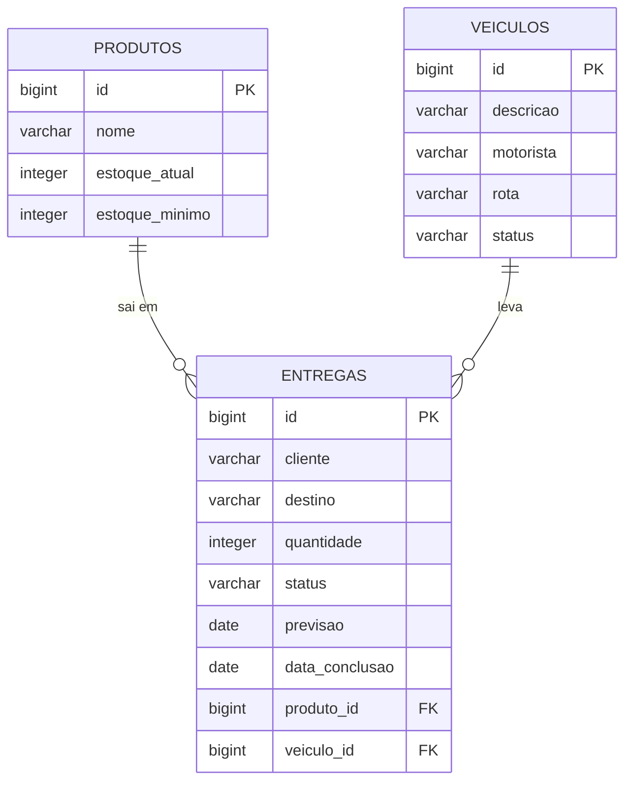

# Modelo de domínio

Três entidades: **Produto** (estoque), **Veiculo** (frota) e **Entrega** (rastreamento). A entrega liga as outras duas: leva uma quantidade de um produto, num veículo.

O desenho nasceu do banco que o grupo modelou primeiro (`controleestoque`, `controlefrota` e `rastreamentoentregas`, num dump do PostgreSQL que serviu só de ponto de partida e não faz parte deste repositório). Na API as tabelas ganharam nomes no plural e em `snake_case`, id gerado pelo banco e os campos que as regras de negócio precisam (`quantidade` e `data_conclusao` na entrega).

## Entidades

### Produto

Um produto guardado no estoque, com a quantidade atual e o estoque mínimo de segurança.

| Atributo | Tipo Java | Coluna | Obrigatório | Regra |
|---|---|---|---|---|
| `id` | `Long` | `id` | sim | Gerado pelo banco |
| `nome` | `String` | `nome` | sim | Até 50 caracteres |
| `estoqueAtual` | `Integer` | `estoque_atual` | sim | Zero ou mais. Depois do cadastro, só muda pelas entregas (R1 e R4) |
| `estoqueMinimo` | `Integer` | `estoque_minimo` | sim | Zero ou mais. É a reserva que nenhuma entrega pode usar (R1) |

Na resposta, a API também calcula `disponivelParaEntrega` (`estoqueAtual - estoqueMinimo`, nunca negativo) e `abaixoDoMinimo`.

### Veiculo

Um veículo da frota, com o motorista e a rota que atende.

| Atributo | Tipo Java | Coluna | Obrigatório | Regra |
|---|---|---|---|---|
| `id` | `Long` | `id` | sim | Gerado pelo banco |
| `descricao` | `String` | `descricao` | sim | Até 50 caracteres (modelo e placa) |
| `motorista` | `String` | `motorista` | sim | Até 50 caracteres |
| `rota` | `String` | `rota` | sim | Até 100 caracteres |
| `status` | `StatusVeiculo` | `status` | sim | `DISPONIVEL` ou `EM_ROTA`. Nasce `DISPONIVEL`; o cliente não controla (R2 e R3) |

### Entrega

Uma entrega rastreada: o que sai do estoque, para qual cliente, em qual veículo e em que situação está.

| Atributo | Tipo Java | Coluna | Obrigatório | Regra |
|---|---|---|---|---|
| `id` | `Long` | `id` | sim | Gerado pelo banco |
| `cliente` | `String` | `cliente` | sim | Até 50 caracteres |
| `destino` | `String` | `destino` | sim | Até 100 caracteres |
| `quantidade` | `Integer` | `quantidade` | sim | Maior que zero; sai do estoque do produto (R1) |
| `status` | `StatusEntrega` | `status` | sim | `EM_TRANSITO`, `ENTREGUE` ou `CANCELADA`. Nasce `EM_TRANSITO`; o cliente não controla (R3) |
| `previsao` | `LocalDate` | `previsao` | sim | Hoje ou depois |
| `dataConclusao` | `LocalDate` | `data_conclusao` | não | Preenchida pela API ao concluir ou cancelar |
| `produto` | `Produto` | `produto_id` | sim | Chave estrangeira para `produtos` |
| `veiculo` | `Veiculo` | `veiculo_id` | sim | Chave estrangeira para `veiculos` |

## Relacionamentos

| De | Para | Tipo | No banco | No código |
|---|---|---|---|---|
| Entrega | Produto | muitos para um | `entregas.produto_id` referencia `produtos(id)` | `@ManyToOne` em `Entrega` |
| Entrega | Veiculo | muitos para um | `entregas.veiculo_id` referencia `veiculos(id)` | `@ManyToOne` em `Entrega` |

## Diagrama ER

Como ler: `||--o{` é "um para muitos". Um produto sai em zero ou várias entregas, e cada entrega é de exatamente um produto. O mesmo vale para o veículo: ao longo do tempo ele leva várias entregas, mas só uma de cada vez (R2).

## Migrations

Todas existem em `src/main/resources/db/migration`, uma tabela por arquivo.

| Versão | Arquivo | O que cria |
|---|---|---|
| V1 | `V1__criar_produtos.sql` | Tabela `produtos` |
| V2 | `V2__criar_veiculos.sql` | Tabela `veiculos` |
| V3 | `V3__criar_entregas.sql` | Tabela `entregas`, com as duas chaves estrangeiras |
